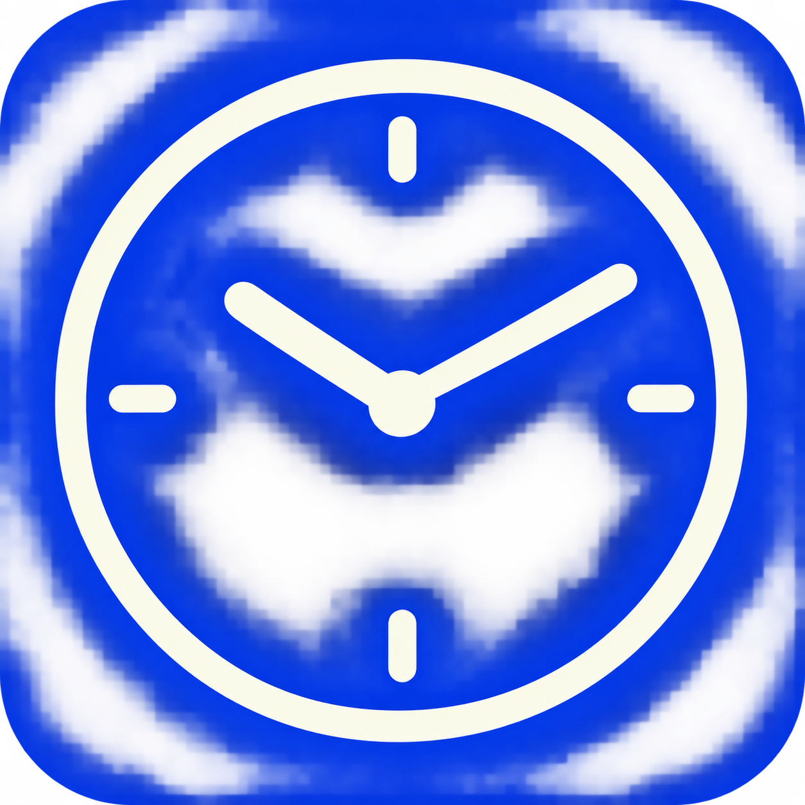
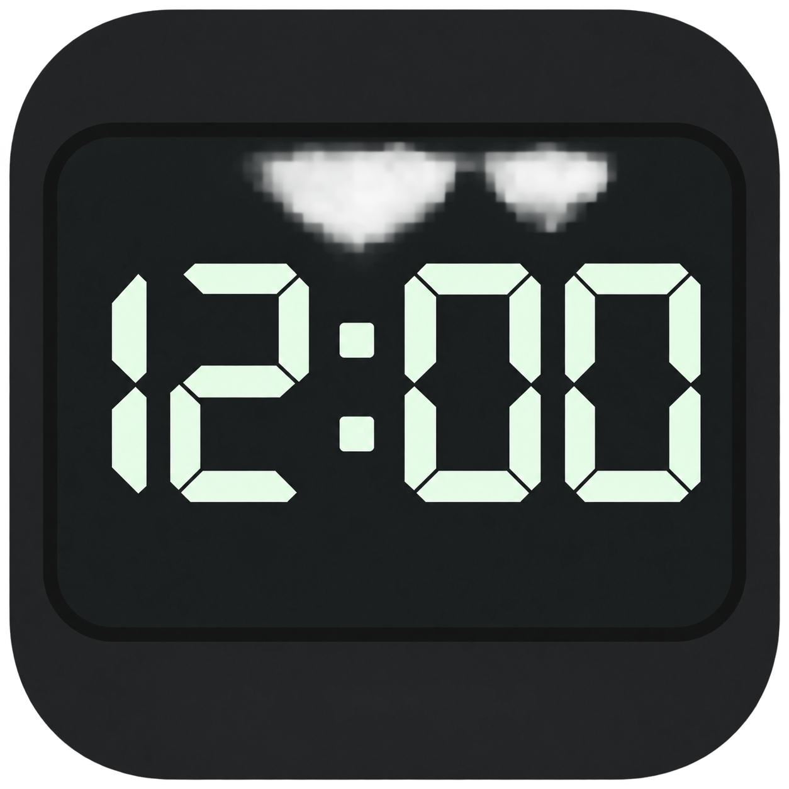
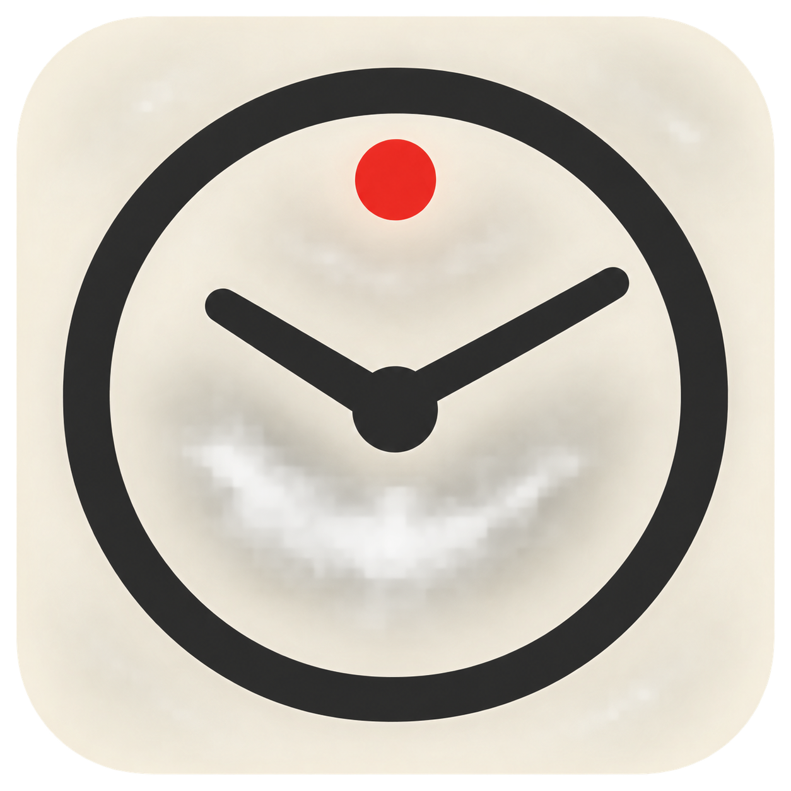
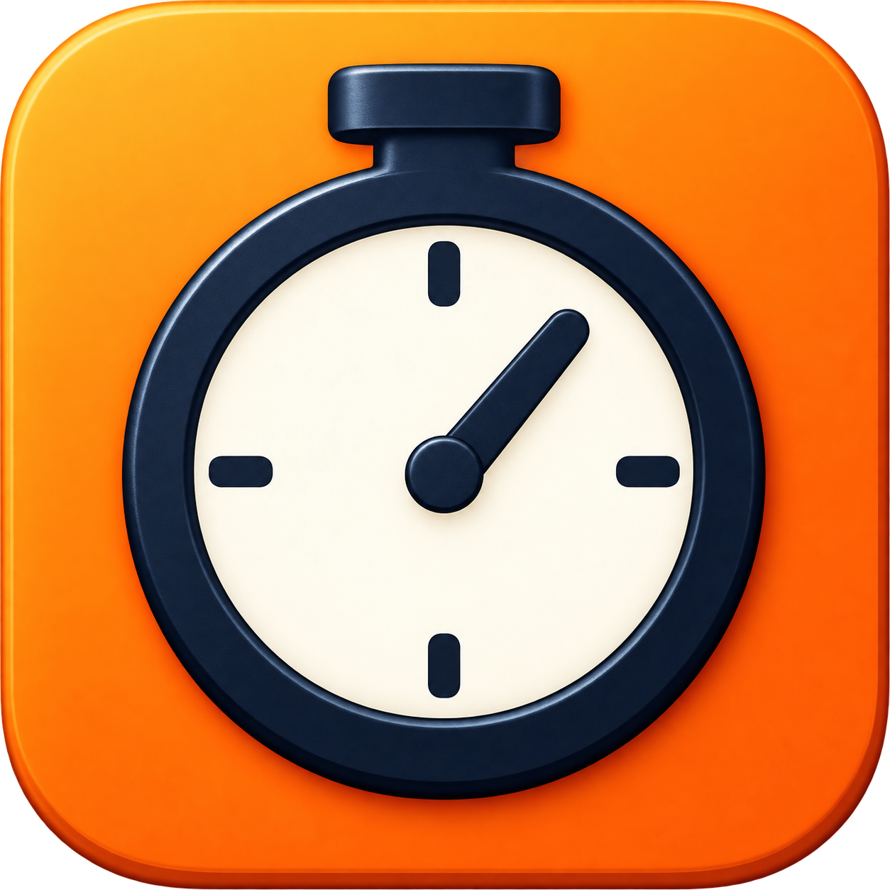
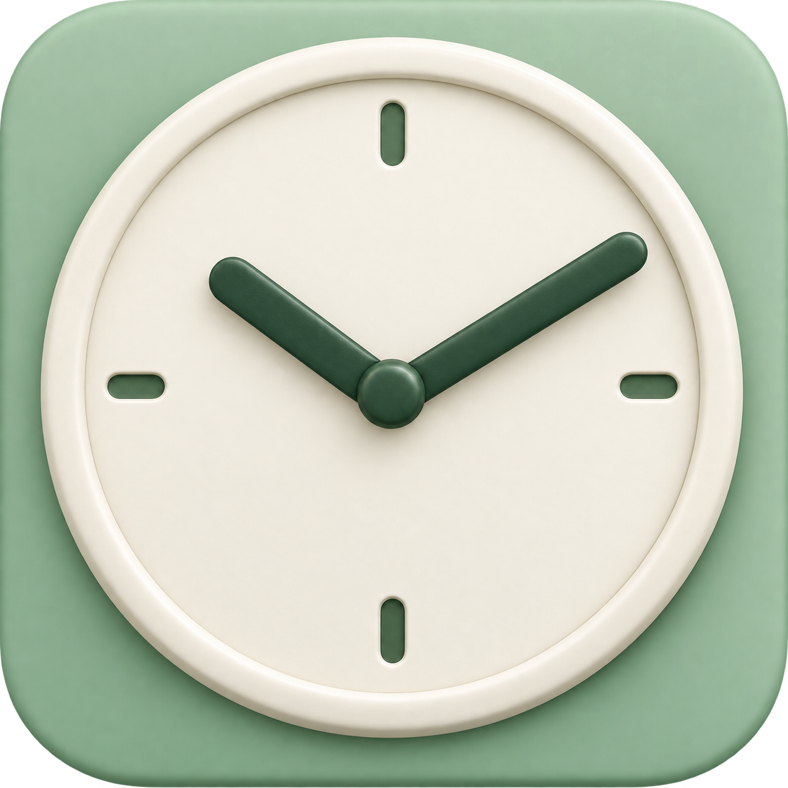

# StreamClock アイコン方向性 5案

GitHub同期: main = origin/main = a919a3a、ソース v1.0.2。旧履歴は codex/backup-before-sync-20260915 に保存。

Creative Production の方針に基づき、内蔵 ImageGen で各案を個別生成。サブエージェント不使用。

採用: **04-stopwatch.png（オレンジ色のストップウォッチ）**。ユーザー選択に基づき、製品の PNG・Windows ICO・macOS ICNS と起動中のウィンドウアイコンに適用。

再生成（Windows PowerShell、リポジトリのルートから）:

```powershell
./scripts/export-icon.ps1 -SourcePath ./design/icon-concepts/2026-09-15/04-stopwatch.png
```

書き出しでは元画像のデザインを変更せず、System.Drawing でリサイズし、PNG/ICO/ICNS へ格納する。

## 1. ミニマル時計



生成プロンプト:

Use case: logo-brand. Create ONE polished square app icon concept for StreamClock, a Windows/macOS digital clock overlay for broadcast production. Direction 1: radically minimal iconic analog clock. Full bleed deep ultramarine blue rounded-square tile, one enormous crisp ivory circular clock rim, two bold ivory hands indicating 10:10, small central pivot, only four simple hour ticks. Flat vector-like graphic with immaculate geometry, strong silhouette readable at 32 px. Clock occupies 75 percent of tile. No text, numbers, gradients, badges, radio waves, arrows, play symbol, speakers, extra objects, presentation sheet or mockup. Single icon centered, square 1024x1024.

## 2. デジタル表示



生成プロンプト:

Use case: logo-brand. Create ONE square app icon for StreamClock desktop broadcast digital clock. Direction 2: pure digital instrument. Near-black graphite rounded-square tile. Enormous perfectly readable mint-white seven-segment digits "12:00" centered across tile, generous clean margins, a very subtle dark inset rounded rectangular display. Precise flat geometric design, only the four digits and colon as focal subject, legible as a clock at small app icon size. No analog clock, no small text, no JST, no buttons, no speaker, no radio or sync symbols, no gradients or glowing haze, no perspective. One standalone square icon, not collage, 1024x1024.

## 3. ON AIR 時計



生成プロンプト:

Use case: logo-brand. One polished square desktop app icon for StreamClock broadcast clock overlay. Direction 3: ON AIR clock, striking editorial graphic identity. Warm ivory rounded square tile. Huge bold charcoal circular analog clock ring and two broad hands at 10:10, central dot. A single vermilion red recording dot replaces the twelve o'clock hour marker INSIDE the dial, integrated not a separate badge. Flat screenprint-like solid shapes with perfect crisp edges, no texture. Extremely simple, powerful contrast, clock unmistakable at 32px. Only clock and red hour dot; no numerals, text, LIVE wording, antenna, wave, arrows, play symbol, speaker, gradients, objects, mockup or collage. Straight-on single square 1024x1024 app icon.

## 4. 精密ストップウォッチ



生成プロンプト:

Use case: logo-brand. Create a single professional square StreamClock desktop app icon concept. Direction 4: precision stopwatch, technical timing utility. Saturated warm orange rounded-square tile with a large dark midnight navy stopwatch silhouette centered, a single short wide crown at top, generous silhouette, ivory dial, one thick navy timer hand pointing about 1 o'clock, just four bold hour ticks and a small pivot. Minimal crisp vector-like graphic with a subtle machined edge for premium utility feel, restrained depth. Prioritize recognition at 32px. No text, no numbers, no other buttons, no tiny scales, no extra symbols, no radio, no arrows, no audio imagery. Clock silhouette takes 80% of icon height. Single square icon, not mockup or collage, 1024x1024.

## 5. 柔らかな立体時計



生成プロンプト:

Use case: logo-brand. Generate ONE square premium desktop app icon for StreamClock. Direction 5: soft sculptural clock, approachable calm utility. Full-bleed muted mint green rounded-square tile containing ONE very large warm ivory circular ceramic clock face, front-on orthographic. Two substantial deep forest green rounded hands indicating 10:10 with a central pivot, four simple inset hour indices, softly raised ivory bezel, restrained tactile clay/ceramic material and delicate shadows. Beautiful simplicity with large bold readable hands, clock fills 80% of tile, all surfaces immaculate. No text or numerals, no alarm bells, no feet, no radio, no speakers, no badges, no play button, no sync arrows, no additional objects, no illustration scene, no collage. Single 1024x1024 app icon.
